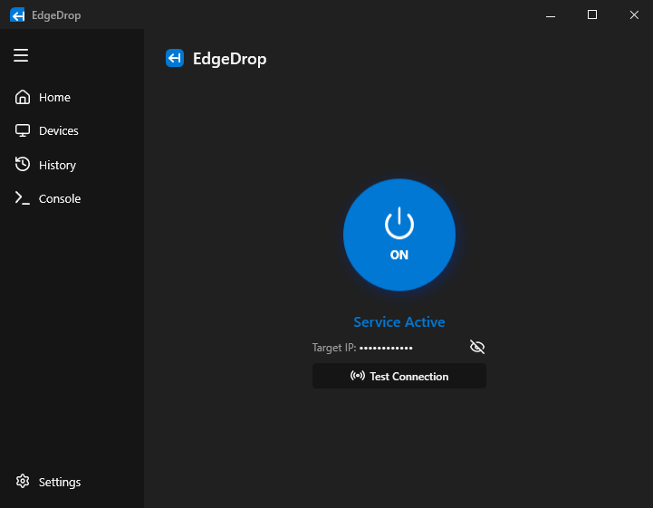

<div align="center">

# EdgeDrop

Local network peer-to-peer file transfer application for Windows.

[](https://github.com/LegoManchik/EdgeDrop/actions/workflows/ci.yml)
[](https://github.com/LegoManchik/EdgeDrop/releases)
[](https://dotnet.microsoft.com/)
[](https://microsoft.com/windows)
[](https://github.com/LegoManchik)
[](LICENSE)

[Features](#features) • [Screenshots](#screenshots) • [Installation](#installation) • [Usage](#usage) • [Building](#building) • [Network & Security](#network--security) • [License](#license)

</div>

---

## Overview

EdgeDrop is a desktop application for sending and receiving files across a local area network (LAN / Wi-Fi). File transfers are conducted directly between devices without cloud services, accounts, or third-party servers.

The application supports:
- Direct PC-to-PC file transfer over TCP sockets.
- Screen edge drop target for dispatching files to assigned devices.
- PC-to-mobile transfer via an embedded HTTP server and web interface.

---

## Screenshots

<p align="center">
  
</p>

---

## Features

- **Peer-to-Peer Transfer**: Direct TCP streaming with chunked I/O.
- **Automatic Discovery**: Peer detection on the local network via UDP broadcast beacons.
- **Screen Edge Drop**: Slide-out drop panel triggered when files are dragged to configured screen boundaries (Left, Right, Top, Bottom).
- **Web Interface for Mobile Devices**: Built-in HTTP server providing file upload and download through a browser; connection via QR code.
- **Windows Explorer Integration**: Shell context menu option (`Send with EdgeDrop`).
- **Transfer Monitoring**: Live display of current speed, transferred bytes, percentage, and ETA on both sender and receiver.
- **Transfer History**: Persistent log of transfers with filtering by status, peer, and direction.
- **System Tray**: Minimization to Windows notification area with background operation and toast notifications.
- **Localization**: English and Russian languages with automatic system detection.
- **Appearance & Themes**: Dark/Light and customizable color palettes with smooth Fluent-style animations.
- **Security & Safe Mode**: Batch-level approvals and safe mode execution prevention.
- **Local Operation**: Operates strictly within local subnet; no telemetry or data collection.

---

## Installation

### Installer
1. Download `EdgeDrop_v1.0.0.exe` from [Releases](https://github.com/LegoManchik/EdgeDrop/releases).
2. Run the setup wizard.
3. Configurable options:
   - Desktop shortcut creation.
   - Run on Windows startup.
   - Windows Explorer context menu registration.

### Portable
1. Download `EdgeDrop_v1.0.0_Portable.zip` from [Releases](https://github.com/LegoManchik/EdgeDrop/releases).
2. Extract the archive.
3. Run `EdgeDrop.exe`.

---

## Usage

### PC to PC
1. Connect both computers to the same local network (Wi-Fi or Ethernet).
2. Launch EdgeDrop on both machines. Devices appear in the device list via UDP broadcast.
3. Drag files onto a device in the list, or drag files to the configured screen edge.

### PC to Mobile / Other OS
1. Open EdgeDrop and open the Web Transfer section.
2. Scan the QR code with the mobile device's camera or navigate to the displayed URL in any browser.
3. Upload or download files using the web interface.

---

## Building

### Requirements
- Windows 10 (version 1809+) or Windows 11 (x64)
- [.NET 8.0 SDK](https://dotnet.microsoft.com/download/dotnet/8.0)
- Inno Setup 6 (optional, for installer build)

### Build Steps

```bash
# Clone the repository
git clone https://github.com/LegoManchik/EdgeDrop.git
cd EdgeDrop

# Restore dependencies
dotnet restore EdgeDrop.sln

# Build solution
dotnet build EdgeDrop.sln -c Release

# Publish binaries
dotnet publish EdgeDrop/EdgeDrop.csproj -c Release -r win-x64 --self-contained false -o publish

# Build installer (requires iscc in PATH)
iscc EdgeDrop_Setup.iss
```

---

## Network & Security

- **Ports**: Default port is `11000` (configurable in settings).
  - UDP `11000`: Local peer discovery beacons.
  - TCP `11000`: File transfer stream and embedded HTTP web server.
- **Approval Prompt**: Incoming file transfers require manual confirmation by default.
- **Path Sanitization**: Received filenames are validated to block directory traversal (`../`).
- **Scope**: No outbound or inbound traffic leaves the local network.

---

## License

MIT License. See [LICENSE](LICENSE) for details.

## Author

Developed by [LegoManchik](https://github.com/LegoManchik).
